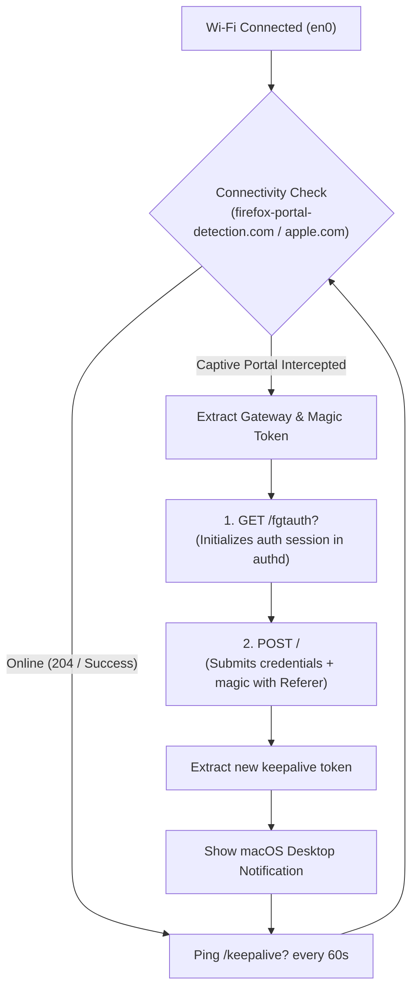

# Inha / IUT Wi-Fi Auto-Login & Keep-Alive (macOS)

[](https://apple.com)
[](https://python.org)
[](LICENSE)

An automated background service and CLI tool for **Inha University in Tashkent (IUT)** students. Automatically authenticates through the campus & dormitory captive portals, prevents the 3-hour session drop, and auto-reconnects when waking your Mac from sleep.

---

## ⚡ The Problem It Solves

If you connect to **"IUT"** (Campus) or **"Inha"** (Dormitory) Wi-Fi:
1. **The 3-Hour Session Timeout:** The FortiGate firewall expires sessions after 10,800 seconds (3 hours) unless a browser keepalive tab remains open.
2. **Glitchy Captive Popup:** macOS's Captive Network Assistant (CNA) popup window often fails to appear when your session expires, or closes itself immediately upon login (which kills FortiGate's keepalive countdown).
3. **Sleep / Wake Drops:** Every time you close your laptop lid, commute between the dorm and campus, or re-associate with Wi-Fi, you get disconnected.

This tool runs as a lightweight, native macOS **LaunchAgent** daemon that runs in the background with zero battery impact and zero third-party dependencies.

---

## ✨ Features

* **🔄 Session Keep-Alive Heartbeat:** Sends a lightweight ping to FortiGate's `/keepalive?<token>` every 60 seconds. **Your internet session will never expire.**
* **⚡ Instant Re-Authentication:** Detects network drops, lid opens, and captive portal redirects within 15–30 seconds and automatically logs back in.
* **🏫 Dual-Campus Support:** Automatically detects whether you are at the **Dormitory** (`gwd.inha.uz:1003`) or **Campus** (`gw-iut.inha.uz:1003`).
* **🔔 Native macOS Notifications:** Shows a subtle notification when successfully authenticated.
* **⌨️ Tab Autocomplete:** Full `zsh` autocomplete support (`inha-wifi ` + <kbd>Tab</kbd>).
* **🔒 Secure & Private:** Credentials are saved locally on your Mac at `~/.config/inha-wifi/config.json` with strict `chmod 600` permissions. Zero analytics, zero third-party dependencies.

---

## 🚀 Quick Start (Installation)

Open Terminal and run:

```bash
git clone https://github.com/ibrohim-b/inha-wifi-autologin.git
cd inha-wifi-autologin
chmod +x install.sh
./install.sh
```

The installer will:
1. Prompt you for your student credentials (`Student ID` and `Wi-Fi Password`).
2. Install the `inha-wifi` and `iut-wifi` CLI commands to `~/.local/bin`.
3. Enable Zsh tab autocompletion.
4. Register and start the background auto-login service (`LaunchAgent`).

---

## 💻 CLI Commands

You can use either `inha-wifi` or `iut-wifi` interchangeably:

| Command | Description |
| :--- | :--- |
| `inha-wifi status` | Check Wi-Fi interface, IP address, portal status, and daemon state |
| `inha-wifi login` | Force an immediate captive portal check and authentication |
| `inha-wifi logout` | Log out from the captive portal (useful for testing auto-recovery) |
| `inha-wifi logs` | Stream real-time background logs (`tail -f`) |
| `inha-wifi restart` | Restart the background LaunchAgent daemon |
| `inha-wifi stop` | Stop and disable the background service |
| `inha-wifi start` | Enable and start the background service |
| `inha-wifi config` | View or reconfigure your credentials |

---

## 🧪 Testing the Setup

To verify that the daemon automatically logs you back in:

```bash
inha-wifi logout
```

Within 10–20 seconds, the background service will detect the captive portal, authenticate with FortiGate, restore internet, and send a desktop notification:
> **Inha / IUT Wi-Fi**  
> *Connected & Authenticated (Dormitory)*

---

## ⚙️ How It Works (Technical Architecture)



1. **Detection:** Queries `http://firefox-portal-detection.com/generate_204` or `http://captive.apple.com/hotspot-detect.html`.
2. **Gateway Resolution:** Maps subnet gateways (`172.18.10.1` &rarr; `gwd.inha.uz:1003`, `192.168.31.254` &rarr; `gw-iut.inha.uz:1003`).
3. **Session Initialization:** Sends `GET /fgtauth?<magic>` with browser headers to initialize FortiGate's `authd` daemon.
4. **Credential Submission:** Sends `POST /` with the form payload and appropriate `Origin` and `Referer` headers.
5. **Keepalive Loop:** Retains the countdown token and pings `/keepalive?<token>` every 60 seconds to refresh the firewall timer indefinitely.

---

## 💡 (Optional) Disable the Annoying macOS Popup

Because the daemon handles all authentication silently, you can disable macOS's built-in captive portal popup window so it never interrupts you:

```bash
sudo defaults write /Library/Preferences/SystemConfiguration/com.apple.captive.control Active -bool false
```

*(To re-enable it in the future, change `false` to `true`).*

---

## 🗑️ Uninstallation

If you ever wish to remove the tool:

```bash
cd inha-wifi-autologin
./uninstall.sh
```

---

## 📄 License

Distributed under the [MIT License](LICENSE).
